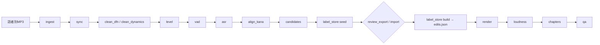

# podcast-editing

**English:** Scripts, thin agent skills and a playbook for editing a Japanese multi-speaker podcast deterministically on a CPU-only Linux box (Zencastr per-speaker tracks → clean → VAD/ASR/kana alignment → reviewable edit list → render → -16 LUFS / -1 dBTP → chapters → QA). Docs are in Japanese.

## これは何か
話者別トラックから日本語ポッドキャストを決定的（同じ入力 → 同じ出力、ハッシュ一致）に編集するパイプライン。すべての編集は `work/edits.json` に明示され、隠れた編集はない。パラメータは [config.yaml](config.yaml) が唯一の正。



## 使い方
```bash
./run_pipeline.sh EP prep --track host=host.mp3 --track guest_a=a.mp3 --track guest_b=b.mp3 [--transcript t.txt]
# review: EP/work/review_labels.txt を Audacity で確認 → review_import.py / label_store.py set|approve
./run_pipeline.sh EP finish
tools/determinism.sh OUTROOT - --track ...   # 2 回実行してハッシュ比較
```
エピソードフォルダはリポジトリ外に置く（音声・氏名・ID をコミットしない）。

## スクリプト（pipeline/）
ingest · sync · clean_dfn · clean_dynamics · level · vad · asr · align_kana · candidates · label_store · review_export · review_import · render · loudness · chapters · qa（共通: common.py）。テスト: `pytest tests`。

## 環境
- CPU Linux, ffmpeg 7.1.5 + libmp3lame 3.100 + libsoxr（ingest がバージョンを検証）
- venv 2 つ（uv）: `requirements/dfn_asr.lock.txt`（torch 2.0.1, DeepFilterNet 0.5.6, faster-whisper 1.2.1）と `requirements/main.lock.txt`（torch 2.8, silero-vad, fugashi+unidic-lite, pyopenjtalk-plus, pedalboard, mutagen, pytest）
- モデル: kotoba-whisper-v2.0-faster（revision 固定）, DeepFilterNet3, torchaudio MMS_FA, Silero VAD

詳細: [playbook/editing-playbook.md](playbook/editing-playbook.md) / 技術選定メモ（履歴）: [playbook/strategy.md](playbook/strategy.md)

## License
MIT
