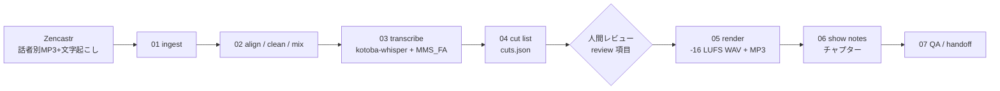

# podcast-editing

**English:** Agent skills and a playbook for editing a Japanese multi-speaker podcast end to end on a CPU-only Linux box: ingest Zencastr per-speaker tracks, clean, transcribe, build a reviewable cut list, render to -16 LUFS, write show notes, and QA. Documentation is in Japanese.

## これは何か
Zencastr で収録した話者別トラックから、日本語ポッドキャストを決定的（同じ入力→同じ出力）に編集するためのエージェント用スキル集と編集プレイブックです。すべてのカットは `cuts.json` に明示され、隠れた編集はありません。

## パイプライン概要

## ステップ
| # | スキル | 内容 |
|---|---|---|
| – | [podcast-edit-pipeline](skills/podcast-edit-pipeline/SKILL.md) | 01–07 を順に実行 |
| 1 | [podcast-01-ingest](skills/podcast-01-ingest/SKILL.md) | 素材取込・manifest 作成 |
| 2 | [podcast-02-align-mix](skills/podcast-02-align-mix/SKILL.md) | 同期・整音・ミックス |
| 3 | [podcast-03-transcribe](skills/podcast-03-transcribe/SKILL.md) | 話者別文字起こし |
| 4 | [podcast-04-cut-list](skills/podcast-04-cut-list/SKILL.md) | カットリスト作成 |
| 5 | [podcast-05-render](skills/podcast-05-render/SKILL.md) | カット適用・ラウドネス・書き出し |
| 6 | [podcast-06-show-notes](skills/podcast-06-show-notes/SKILL.md) | ショーノート・チャプター |
| 7 | [podcast-07-qa-handoff](skills/podcast-07-qa-handoff/SKILL.md) | QA・納品 |

詳細手順: [playbook/editing-playbook.md](playbook/editing-playbook.md) / 技術選定メモ: [playbook/strategy.md](playbook/strategy.md) / パラメータ: [config.example.yaml](config.example.yaml)

## 必要環境
- CPU のみの Linux（目安 8 vCPU / 15GB RAM）、ffmpeg 7.x
- Python 3.11 の venv（uv 推奨。3.13 では DeepFilterNet 等の依存が入らない場合あり）
- モデル・ライブラリ
  - ASR: faster-whisper + **kotoba-whisper-v2.0**（`compute_type=float32`、int8 不可）
  - ノイズ除去: **DeepFilterNet3**
  - 強制アライメント: **torchaudio `MMS_FA`**（+ uroman）
  - EQ/ダイナミクス: **pedalboard**
  - ラウドネス測定: **pyloudnorm**（最終は ffmpeg loudnorm 2パス）

`tools/smoke/` に CPU 速度確認用のスモークテストがあります。音声・モデルは含みません。

## License
MIT
